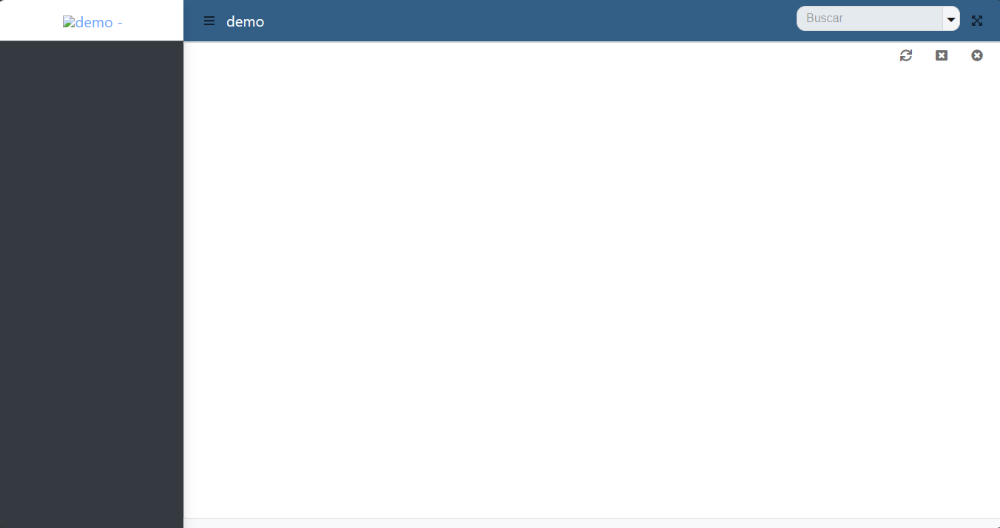
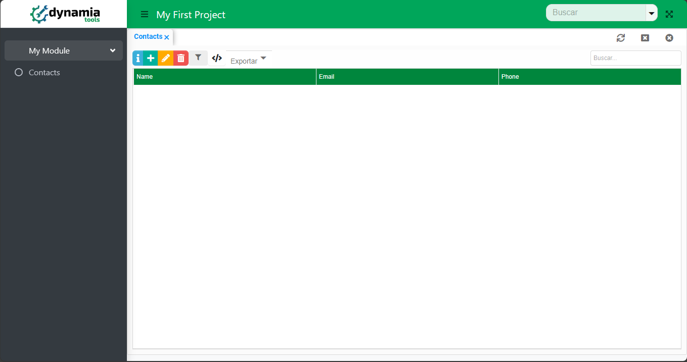
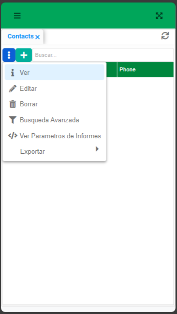

import { Aside, Steps, Tabs, TabItem, FileTree, Code, LinkCard, CardGrid } from '@astrojs/starlight/components';
import { dynamiaToolsVersion } from '../../../../astro.config.mjs';

Esta guía te lleva de cero a una aplicación en ejecución: un backend Spring Boot con la plataforma ya integrada y un frontend Vue 3 que se conecta a él. Después agregas tu primera entidad y ves aparecer la pantalla y la API REST.

La forma más rápida de empezar es el **CLI de Dynamia**. Si ya tienes un proyecto Spring Boot, ve a [agregar Dynamia a un proyecto existente](#agregar-dynamia-a-un-proyecto-existente).

<Aside type="note" title="Lo que necesitas">
Node.js 24 o superior, Git y JDK 25. En Linux y macOS el instalador de una línea configura el JDK y Node.js por ti.
</Aside>

## Crea un proyecto con el CLI

<Steps>

1. **Instala el CLI.**

   <Tabs>
     <TabItem label="Una línea (Linux y macOS)">
       Instala JDK 25, Node.js y el CLI:

       ```bash
       curl -fsSL https://get.dynamia.tools | bash
       ```
     </TabItem>
     <TabItem label="npm">
       Si ya tienes Node.js 24+, Git y JDK 25:

       ```bash
       npm install -g @dynamia-tools/cli
       ```
     </TabItem>
   </Tabs>

2. **Crea el proyecto.**

   ```bash
   dynamia new
   ```

   El asistente pregunta el nombre del proyecto, qué generar (backend, frontend o ambos), el lenguaje del backend (**Java**, **Kotlin** o **Groovy**), tus coordenadas Maven, el frontend (**Vue 3**) y tu gestor de paquetes. Muestra un resumen antes de generar nada.

3. **Ejecútalo.** El CLI crea dos carpetas:

   <FileTree>

   - my-erp
     - backend Spring Boot con Dynamia Platform
     - frontend Vue 3, Vite y @dynamia-tools/vue

   </FileTree>

   ```bash
   cd my-erp/backend && ./mvnw spring-boot:run     # backend en http://localhost:8080
   cd my-erp/frontend && pnpm dev                  # frontend (usa npm o yarn si los elegiste)
   ```

   El backend incluye Spring Data JPA con una base de datos en memoria, así que funciona sin configurar nada.

</Steps>

<Aside type="tip" title="Scripts y CI">
Pasa banderas para omitir todas las preguntas:

```bash
dynamia new --name my-erp --scaffold both --backend-lang kotlin \
  --group-id com.acme --artifact-id erp --frontend vue --pm pnpm --yes
```

Consulta la [referencia del CLI](/es/ecosystem/cli) para ver todas las banderas. El CLI está en beta: cuando una plantilla no está lista recibes un mensaje claro con un código de soporte en lugar de un proyecto roto.
</Aside>

## Agrega tu primera entidad

Dynamia tiene una idea en el centro: tu modelo de dominio guía todo lo demás. Tres pasos pequeños te dan una pantalla completa y una API REST. Los ejemplos están en Java; las mismas clases funcionan en Kotlin y Groovy.

<Steps>

1. **Modela tu dominio.** Una entidad JPA simple. Extiende `BaseEntity` para obtener el id, los campos de auditoría y el soporte CRUD.

   ```java
   //backend/src/main/java/com/acme/erp/library/Book.java
   package com.acme.erp.library;

   import jakarta.persistence.Entity;
   import jakarta.validation.constraints.NotEmpty;
   import tools.dynamia.domain.jpa.BaseEntity;

   import java.math.BigDecimal;

   @Entity
   public class Book extends BaseEntity {

       @NotEmpty
       private String title;
       private String author;
       private BigDecimal price;

       // getters y setters
   }
   ```

2. **Describe las pantallas.** Un descriptor de vista YAML declara cada vista. Sin plantillas y sin código repetitivo.

   ```yaml
   # backend/src/main/resources/META-INF/descriptors/BookForm.yml
   view: form
   beanClass: com.acme.erp.library.Book
   fields:
     title:
     author:
     price:
   ```

   ```yaml
   # backend/src/main/resources/META-INF/descriptors/BookTable.yml
   view: table
   beanClass: com.acme.erp.library.Book
   fields:
     title:
     author:
     price:
   ```

3. **Ponla en la navegación.** Un módulo ubica la entidad en tu aplicación con una línea.

   ```java
   //backend/src/main/java/com/acme/erp/library/LibraryModuleProvider.java
   package com.acme.erp.library;

   import tools.dynamia.crud.CrudPage;
   import tools.dynamia.integration.sterotypes.Provider;
   import tools.dynamia.navigation.Module;
   import tools.dynamia.navigation.ModuleProvider;

   @Provider
   public class LibraryModuleProvider implements ModuleProvider {

       @Override
       public Module getModule() {
           return new Module("library", "Library")
                   .addPage(new CrudPage("books", "Books", Book.class));
       }
   }
   ```

</Steps>

Reinicia el backend. Ya tienes un menú **Library** con una página **Books**: lista, búsqueda, crear, editar y eliminar, con validación. Los ids del módulo y de la página definen la ruta, así que esa misma página es `library/books`.

## Mira la API REST

Cada `CrudPage` recibe un endpoint REST, sin código adicional. Crea algunos libros y abre `http://localhost:8080/api/library/books`:

```json
{
  "data": [
    { "id": 1, "title": "Clean Code", "author": "Robert C. Martin", "price": 42.00 },
    { "id": 2, "title": "Effective Java", "author": "Joshua Bloch", "price": 45.00 }
  ],
  "pageable": { "totalSize": 2, "pageSize": 50, "firstResult": 0, "page": 1, "pagesNumber": 1 },
  "response": "OK"
}
```

`/api/library/books/1` devuelve un solo libro. Para filtros, orden y paginación, el mismo endpoint acepta un mensaje de consulta: consulta [Filtros y consultas de listas](/es/guides/list-filters). El frontend Vue y el [SDK de TypeScript](/es/frontend-sdk) usan esta API y los metadatos de la página para dibujar las pantallas, así que una entidad nueva no necesita código de frontend nuevo.

## Elige tu frontend

| Quieres | Usa |
|---|---|
| Una aplicación moderna y desacoplada | **Vue 3** con [`@dynamia-tools/vue`](/es/vue-support) sobre la API REST y el SDK de TypeScript. Es lo que genera el CLI |
| Una interfaz completa sin JavaScript | **ZK**: las pantallas se dibujan en el servidor desde los mismos descriptores |
| Lo mejor de ambos | **Microfrontends**: coloca un paquete de Vue, React o Svelte en cualquier página ZK. Consulta [Incrustar microfrontends](/es/guides/microfrontends) |

## Construye con Claude Code

¿Trabajas con [Claude Code](https://claude.com/claude-code)? El plugin **`dynamia-platform`** le enseña a Claude las convenciones de la plataforma, así que el código que escribe las sigue: entidades y `CrudService`, módulos y `CrudPage`, acciones, descriptores YAML, páginas ZK, los paquetes Vue de `@dynamia-tools` y las extensiones. Lee la documentación oficial en la versión de tu proyecto, y puede instalar el CLI `dynamia` y crear proyectos nuevos por ti.

Instálalo desde el [marketplace `dynamia-tools`](https://github.com/dynamiatools/claude-plugins). Dentro de Claude Code:

```
/plugin marketplace add dynamiatools/claude-plugins
/plugin install dynamia-platform@dynamia-tools
```

O desde una terminal:

```bash
claude plugin marketplace add dynamiatools/claude-plugins
claude plugin install dynamia-platform@dynamia-tools
```

Luego abre Claude Code en tu proyecto y describe lo que necesitas, o llama a una skill directamente:

| Skill | Úsala para |
|---|---|
| `dynamia-platform:cli` | Instalar o actualizar el CLI y crear un proyecto |
| `dynamia-platform:backend` | Entidades, `CrudService`, módulos, acciones, validadores y descriptores de vista |
| `dynamia-platform:vue-frontend` | Paquetes `@dynamia-tools`, acciones del servidor y consultas de listas |
| `dynamia-platform:zk-ui` | Páginas ZUL, view models y microfrontends |
| `dynamia-platform:extensions` | SaaS, reportes, archivos, dashboard, email y SMS, finanzas |
| `dynamia-platform:docs` | La documentación oficial, leída en vivo en la versión de tu proyecto |

## Agregar Dynamia a un proyecto existente

¿Ya tienes una aplicación Spring Boot 4? Agrega la plataforma a mano.

<Tabs>
  <TabItem label="Maven">
    <Code lang="xml" title="pom.xml" code={`<dependencies>
    <dependency>
        <groupId>tools.dynamia</groupId>
        <artifactId>tools.dynamia.app</artifactId>
        <version>${dynamiaToolsVersion}</version>
    </dependency>
    <dependency>
        <groupId>tools.dynamia</groupId>
        <artifactId>tools.dynamia.zk</artifactId>
        <version>${dynamiaToolsVersion}</version>
    </dependency>
    <dependency>
        <groupId>tools.dynamia</groupId>
        <artifactId>tools.dynamia.domain.jpa</artifactId>
        <version>${dynamiaToolsVersion}</version>
    </dependency>
</dependencies>`} />
  </TabItem>
  <TabItem label="Gradle">
    <Code lang="groovy" title="build.gradle" code={`dependencies {
    implementation 'tools.dynamia:tools.dynamia.app:${dynamiaToolsVersion}'
    implementation 'tools.dynamia:tools.dynamia.zk:${dynamiaToolsVersion}'
    implementation 'tools.dynamia:tools.dynamia.domain.jpa:${dynamiaToolsVersion}'
}`} />
  </TabItem>
</Tabs>

Luego habilita la plataforma en tu clase principal:

```java
@SpringBootApplication
@EnableDynamiaTools  // es todo lo que necesitas
public class MyApplication {

    public static void main(String[] args) {
        SpringApplication.run(MyApplication.class, args);
    }
}
```

Ejecútala con `mvn spring-boot:run` (o `gradle bootRun`) y abre `http://localhost:8080`. Verás una página en blanco con una plantilla HTML funcional llamada Dynamical, lista para la entidad, los descriptores y el módulo de los pasos anteriores.



<Aside title="Anotación o autoconfiguración">
Puedes activar la plataforma con `@EnableDynamiaTools`, que es explícito y te deja componer módulos individuales (consulta [Configuración personalizada](/es/custom-setup)), o con la dependencia `dynamia-tools-zk-starter`, que Spring Boot detecta por autoconfiguración y no necesita anotación. Ambos terminan en el mismo lugar.
</Aside>

Todos los artefactos, del núcleo y de las extensiones, comparten la misma versión, así que nunca tienes que hacerlos coincidir. Las extensiones viven bajo el grupo `tools.dynamia.modules`: consulta [Extensiones](/es/extensions/).

### Configuración y apariencia

Usa `application.yml` para personalizar la aplicación. El grupo `dynamia.app` guarda la configuración global:

```yaml
# application.yml
dynamia:
  app:
    name: My First Project
    short-name: MFP
    default-skin: Green
    default-logo: /static/logo.png
    default-icon: /static/icon.png   # se usa cuando la barra de navegación está colapsada
    url: https://www.dynamia.tools
```



La plantilla por defecto, [Dynamical](/es/ecosystem/themes), es una plantilla responsive de Bootstrap 5.



## Siguientes pasos

<CardGrid>
  <LinkCard title="Conceptos clave" description="Módulos, páginas, entidades, vistas y acciones." href="/es/key-concepts/" />
  <LinkCard title="Entidades y Crud Service" description="Modela y persiste tus datos." href="/es/guides/entities/" />
  <LinkCard title="Descriptores de vista" description="Da forma a formularios y tablas con YAML." href="/es/view-descriptors/" />
  <LinkCard title="SDK Frontend y Vue" description="Construye tu propio frontend sobre la API generada." href="/es/frontend-sdk/" />
</CardGrid>
