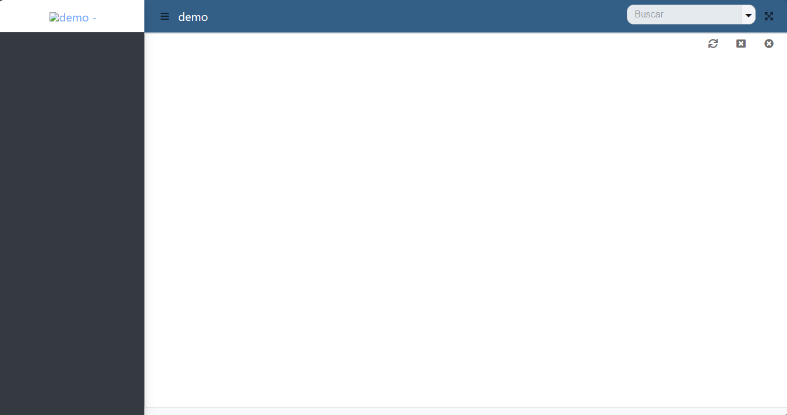
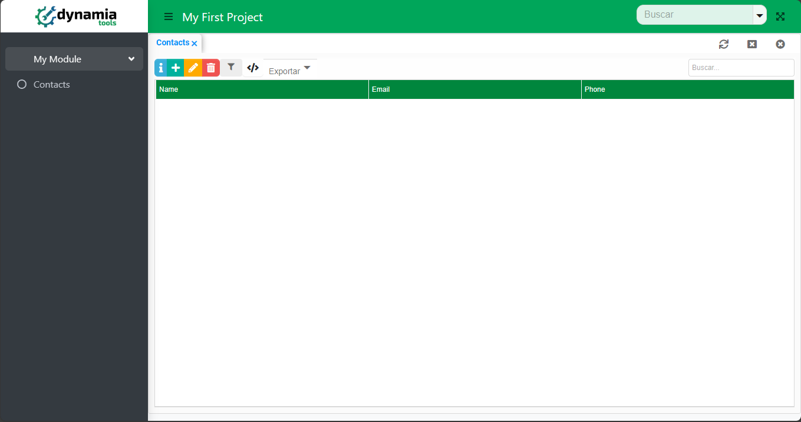
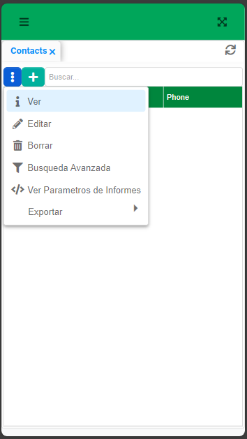

import { Aside, Steps, Tabs, TabItem, FileTree, Code, LinkCard, CardGrid } from '@astrojs/starlight/components';
import { dynamiaToolsVersion } from '../../../astro.config.mjs';

This guide takes you from nothing to a running application: a Spring Boot backend with the platform already wired in, and a Vue 3 frontend that talks to it. Then you add your first entity and see the screen and the REST API appear.

The fastest way to start is the **Dynamia CLI**. If you already have a Spring Boot project, jump to [add Dynamia to an existing project](#add-dynamia-to-an-existing-project).

<Aside type="note" title="What you need">
Node.js 24 or newer, Git and JDK 25. On Linux and macOS the one-line installer sets up the JDK and Node.js for you.
</Aside>

## Create a project with the CLI

<Steps>

1. **Install the CLI.**

   <Tabs>
     <TabItem label="One line (Linux and macOS)">
       Installs JDK 25, Node.js and the CLI:

       ```bash
       curl -fsSL https://get.dynamia.tools | bash
       ```
     </TabItem>
     <TabItem label="npm">
       If you already have Node.js 24+, Git and JDK 25:

       ```bash
       npm install -g @dynamia-tools/cli
       ```
     </TabItem>
   </Tabs>

2. **Create the project.**

   ```bash
   dynamia new
   ```

   The wizard asks for the project name, what to generate (backend, frontend or both), the backend language (**Java**, **Kotlin** or **Groovy**), your Maven coordinates, the frontend (**Vue 3**) and your package manager. It shows a summary before it generates anything.

3. **Run it.** The CLI creates two folders:

   <FileTree>

   - my-erp
     - backend Spring Boot with Dynamia Platform
     - frontend Vue 3, Vite and @dynamia-tools/vue

   </FileTree>

   ```bash
   cd my-erp/backend && ./mvnw spring-boot:run     # backend on http://localhost:8080
   cd my-erp/frontend && pnpm dev                  # frontend (use npm or yarn if you chose them)
   ```

   The backend includes Spring Data JPA with an in-memory database, so it runs without any setup.

</Steps>

<Aside type="tip" title="Scripts and CI">
Pass flags to skip every prompt:

```bash
dynamia new --name my-erp --scaffold both --backend-lang kotlin \
  --group-id com.acme --artifact-id erp --frontend vue --pm pnpm --yes
```

See the [CLI reference](/ecosystem/cli) for every flag. The CLI is in beta: when a template is not ready you get a clear message with a support code instead of a broken project.
</Aside>

## Add your first entity

Dynamia has one idea at its center: your domain model drives everything else. Three small steps give you a complete screen and a REST API. The examples are Java; the same classes work in Kotlin and Groovy.

<Steps>

1. **Model your domain.** A plain JPA entity. Extend `BaseEntity` to get the id, audit fields and CRUD support.

   ```java
   //backend/src/main/java/com/acme/erp/library/Book.java
   package com.acme.erp.library;

   import jakarta.persistence.Entity;
   import jakarta.validation.constraints.NotEmpty;
   import tools.dynamia.domain.jpa.BaseEntity;

   import java.math.BigDecimal;

   @Entity
   public class Book extends BaseEntity {

       @NotEmpty
       private String title;
       private String author;
       private BigDecimal price;

       // getters and setters
   }
   ```

2. **Describe the screens.** A YAML view descriptor declares each view. No templates and no boilerplate.

   ```yaml
   # backend/src/main/resources/META-INF/descriptors/BookForm.yml
   view: form
   beanClass: com.acme.erp.library.Book
   fields:
     title:
     author:
     price:
   ```

   ```yaml
   # backend/src/main/resources/META-INF/descriptors/BookTable.yml
   view: table
   beanClass: com.acme.erp.library.Book
   fields:
     title:
     author:
     price:
   ```

3. **Put it in the navigation.** A module places the entity in your app with one line.

   ```java
   //backend/src/main/java/com/acme/erp/library/LibraryModuleProvider.java
   package com.acme.erp.library;

   import tools.dynamia.crud.CrudPage;
   import tools.dynamia.integration.sterotypes.Provider;
   import tools.dynamia.navigation.Module;
   import tools.dynamia.navigation.ModuleProvider;

   @Provider
   public class LibraryModuleProvider implements ModuleProvider {

       @Override
       public Module getModule() {
           return new Module("library", "Library")
                   .addPage(new CrudPage("books", "Books", Book.class));
       }
   }
   ```

</Steps>

Restart the backend. You now have a **Library** menu with a **Books** page: list, search, create, edit and delete, with validation. The module and page ids define the path, so the same page is `library/books`.

## See the REST API

Every `CrudPage` gets a REST endpoint, with no extra code. Create a few books and open `http://localhost:8080/api/library/books`:

```json
{
  "data": [
    { "id": 1, "title": "Clean Code", "author": "Robert C. Martin", "price": 42.00 },
    { "id": 2, "title": "Effective Java", "author": "Joshua Bloch", "price": 45.00 }
  ],
  "pageable": { "totalSize": 2, "pageSize": 50, "firstResult": 0, "page": 1, "pagesNumber": 1 },
  "response": "OK"
}
```

`/api/library/books/1` returns one book. For filters, sorting and paging, the same endpoint accepts a query message: see [List filters and queries](/guides/list-filters). The Vue frontend and the [TypeScript SDK](/frontend-sdk) use this API and the page metadata to render the screens, so a new entity needs no new frontend code.

## Choose your frontend

| You want | Use |
|---|---|
| A modern, decoupled app | **Vue 3** with [`@dynamia-tools/vue`](/vue-support) on top of the REST API and the TypeScript SDK. This is what the CLI generates |
| A complete UI with no JavaScript | **ZK**: screens are rendered on the server from the same descriptors |
| The best of both | **Microfrontends**: drop a Vue, React or Svelte bundle into any ZK page. See [Embedding microfrontends](/guides/microfrontends) |

## Build with Claude Code

Working with [Claude Code](https://claude.com/claude-code)? The **`dynamia-platform`** plugin teaches Claude the conventions of the platform, so the code it writes follows them: entities and `CrudService`, modules and `CrudPage`, actions, YAML descriptors, ZK pages, the `@dynamia-tools` Vue packages and the extensions. It reads the official documentation at the version of your project, and it can install the `dynamia` CLI and create new projects for you.

Install it from the [`dynamia-tools` marketplace](https://github.com/dynamiatools/claude-plugins). Inside Claude Code:

```
/plugin marketplace add dynamiatools/claude-plugins
/plugin install dynamia-platform@dynamia-tools
```

Or from a terminal:

```bash
claude plugin marketplace add dynamiatools/claude-plugins
claude plugin install dynamia-platform@dynamia-tools
```

Then open Claude Code in your project and describe what you need, or call a skill directly:

| Skill | Use it for |
|---|---|
| `dynamia-platform:cli` | Install or update the CLI and create a project |
| `dynamia-platform:backend` | Entities, `CrudService`, modules, actions, validators and view descriptors |
| `dynamia-platform:vue-frontend` | `@dynamia-tools` packages, server actions and list queries |
| `dynamia-platform:zk-ui` | ZUL pages, view models and microfrontends |
| `dynamia-platform:extensions` | SaaS, reports, files, dashboard, email and SMS, finances |
| `dynamia-platform:docs` | The official docs, read live at your project's version |

## Add Dynamia to an existing project

Already have a Spring Boot 4 application? Add the platform by hand.

<Tabs>
  <TabItem label="Maven">
    <Code lang="xml" title="pom.xml" code={`<dependencies>
    <dependency>
        <groupId>tools.dynamia</groupId>
        <artifactId>tools.dynamia.app</artifactId>
        <version>${dynamiaToolsVersion}</version>
    </dependency>
    <dependency>
        <groupId>tools.dynamia</groupId>
        <artifactId>tools.dynamia.zk</artifactId>
        <version>${dynamiaToolsVersion}</version>
    </dependency>
    <dependency>
        <groupId>tools.dynamia</groupId>
        <artifactId>tools.dynamia.domain.jpa</artifactId>
        <version>${dynamiaToolsVersion}</version>
    </dependency>
</dependencies>`} />
  </TabItem>
  <TabItem label="Gradle">
    <Code lang="groovy" title="build.gradle" code={`dependencies {
    implementation 'tools.dynamia:tools.dynamia.app:${dynamiaToolsVersion}'
    implementation 'tools.dynamia:tools.dynamia.zk:${dynamiaToolsVersion}'
    implementation 'tools.dynamia:tools.dynamia.domain.jpa:${dynamiaToolsVersion}'
}`} />
  </TabItem>
</Tabs>

Then enable the platform on your main class:

```java
@SpringBootApplication
@EnableDynamiaTools  // this is all you need
public class MyApplication {

    public static void main(String[] args) {
        SpringApplication.run(MyApplication.class, args);
    }
}
```

Run it with `mvn spring-boot:run` (or `gradle bootRun`) and open `http://localhost:8080`. You will see a blank page with a working HTML template called Dynamical, ready for the entity, descriptors and module from the steps above.



<Aside title="Annotation or auto-configuration">
You can turn the platform on with `@EnableDynamiaTools`, which is explicit and lets you compose individual modules (see [Custom Setup](/custom-setup)), or with the `dynamia-tools-zk-starter` dependency, which is picked up by Spring Boot auto-configuration and needs no annotation. Both end in the same place.
</Aside>

All artifacts, core and extensions alike, share the same version, so you never have to match them. Extensions live under the `tools.dynamia.modules` group: see [Extensions](/extensions/).

### Settings and look

Use `application.yml` to customize the application. The `dynamia.app` group holds the global settings:

```yaml
# application.yml
dynamia:
  app:
    name: My First Project
    short-name: MFP
    default-skin: Green
    default-logo: /static/logo.png
    default-icon: /static/icon.png   # used when the navigation bar is collapsed
    url: https://www.dynamia.tools
```



The default template, [Dynamical](/ecosystem/themes), is a responsive Bootstrap 5 template.



## Next steps

<CardGrid>
  <LinkCard title="Key concepts" description="Modules, pages, entities, views and actions." href="/key-concepts/" />
  <LinkCard title="Entities and Crud Service" description="Model and persist your data." href="/guides/entities/" />
  <LinkCard title="View descriptors" description="Shape forms and tables with YAML." href="/view-descriptors/" />
  <LinkCard title="Frontend SDK and Vue" description="Build your own frontend on the generated API." href="/frontend-sdk/" />
</CardGrid>
